<p align="center">
  
</p>

<h1 align="center">Mammatus</h1>

<p align="center">
  A self-hosted weather model viewer on a living globe.<br>
  HRRR · RRFS · GFS · ECMWF IFS · ECMWF AIFS · MRMS radar · global satellite · GOES lightning · WPC fronts · NWS alerts
</p>

<p align="center">
  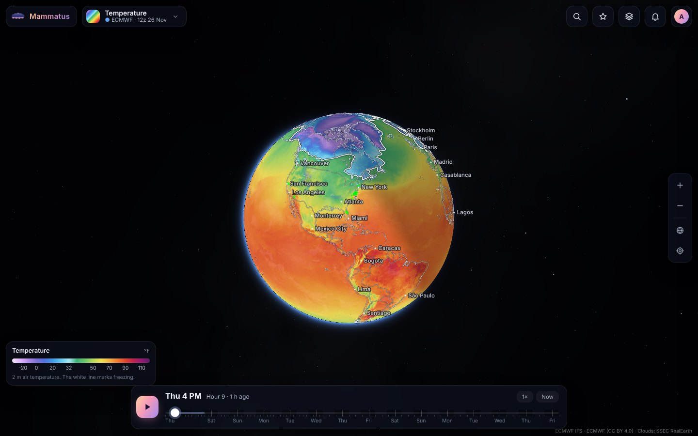
</p>

Mammatus pulls model data straight from NOAA and ECMWF open data, renders it on the GPU over a
realistic Earth (day/night terminator, city lights, atmosphere, stars) that morphs into a flat map as you
zoom in, and adds the tools you actually reach for: multi-model meteograms, skew-T soundings with
hodographs, live radar and satellite, NWS warnings, saved places and real push notifications. It is one
Docker container with a single `/data` volume, built for Unraid behind a reverse proxy, with accounts so
family can use it from anywhere.

## Highlights

- **Five models, one timeline.** HRRR and RRFS (3 km CONUS, hourly), GFS (0.25°, to 16 days), ECMWF IFS and
  AIFS (0.25°, open data). New runs appear automatically; a toast offers to load them.
- **32 products**: temperature, dewpoint, wind with animated flow, gusts, pressure & precipitation type
  with isobars and H/L centers, simulated radar, 1/6/24-h and total precipitation, snowfall at 10:1 and
  **Kuchera** ratios (plus each model's own), freezing rain, snow depth, CAPE (SB/ML/MU), helicity,
  updraft helicity, PWAT, 500 mb vorticity & heights, 850 mb temps, 250 mb jet, 700 mb RH, thickness.
- **Globe ↔ map.** A WebGL2 engine draws the data with per-pixel projection (no tile seams), cross-fades
  between hours, decodes frames off the main thread and draws contours and labels without blocking.
- **Live radar & satellite.** MRMS composite reflectivity every few minutes; global IR / visible / water
  vapor mosaics that also appear as live clouds on the globe.
- **Lightning.** Every flash seen by the GOES-East and GOES-West Geostationary Lightning Mappers, about a
  minute behind real time. Strikes replay in their true rhythm: each one flickers through its return
  strokes, blooms softly and leaves a faint ring, then cools from white to crimson as it ages. In busy
  storms only a few strikes per second flash, so it stays a gentle shimmer rather than strobing. Step
  or play a radar or satellite loop and the lightning that led up to each frame flashes along with it.
  Tap anywhere for the nearest strike ("Lightning 6 mi away · 3 min ago").
- **Fronts.** NOAA WPC's hand-drawn surface analysis (every 3 hours) and its 12–48 hour forecast fronts,
  matched to the timeline: cold, warm, stationary and occluded fronts with proper symbols, troughs, and
  WPC highs and lows when the map isn't already showing model pressure centers.
- **Point forecasts.** Tap anywhere: the value under your finger, active NWS alerts, then a multi-model
  meteogram (HRRR, RRFS, NBM, GFS, ECMWF, AIFS, ICON, GEM, UKMO) with daily consensus highs/lows,
  model spread, accumulated precip and snow, wind, pressure and cloud cover.
- **Soundings.** Skew-T log-p with surface/mixed-layer/most-unstable parcels (virtual-temperature
  corrected CAPE/CIN, LCL/LFC/EL), PWAT, lapse rates, shear, Bunkers storm motion, SRH, STP/SCP and a
  height-colored hodograph.
- **Alerts that reach your phone.** Saved places plus rules: NWS warnings/watches, thresholds
  ("≥ 4 in of snow in the next 3 days" across models), "precipitation starting soon", or new model runs.
  Delivered with standards-based Web Push (VAPID, RFC 8291) — no third-party service.
- **Accounts.** Invite-only users, admin and user roles, TOTP two-step verification, session management,
  password resets by link, an audit log.
- **Installable PWA.** Home-screen app on iOS and Android, offline shell, deep links from notifications.
- **Easy on batteries.** Nothing renders unless something changes; animation idles after 20 s on phones,
  caps at 30 fps in battery-saver mode and stops entirely in the background. Live updates disconnect when
  the app is hidden. Frames are compact (quantized, delta-coded, gzip) and cached immutably.

## Screenshots

| | |
|---|---|
| 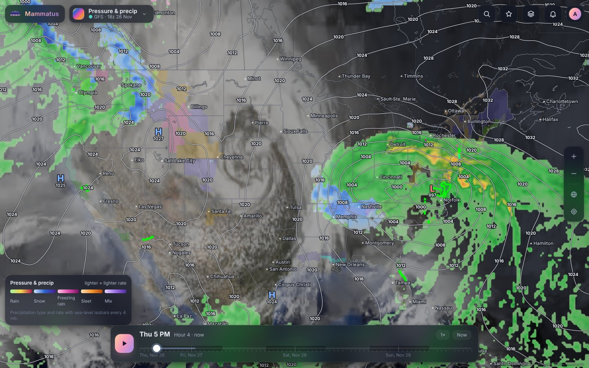 | 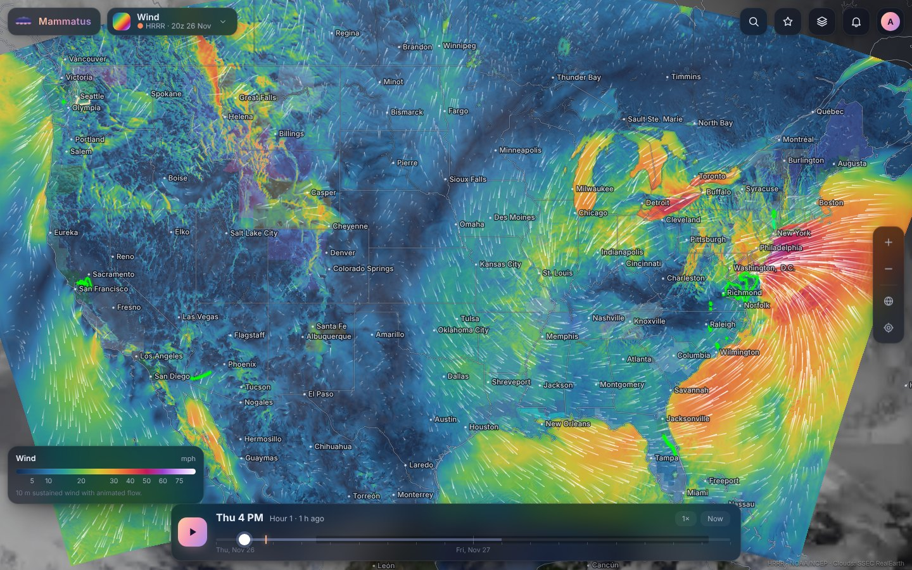 |
| GFS precipitation type with isobars and pressure centers | HRRR 10 m wind with animated particles |
| 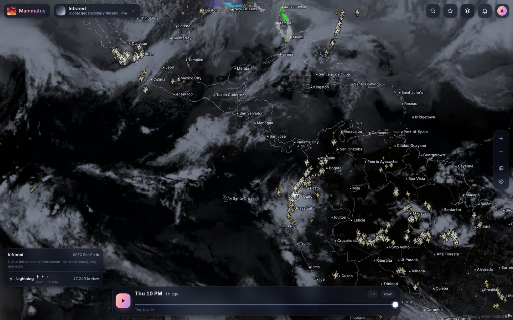 | 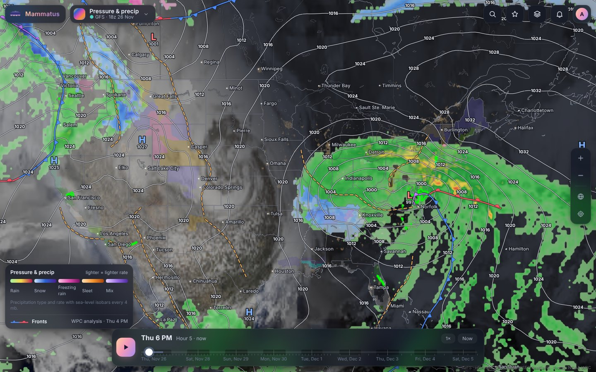 |
| Live GOES lightning over the Amazon, with the infrared satellite | WPC fronts over GFS precipitation type and isobars |
| 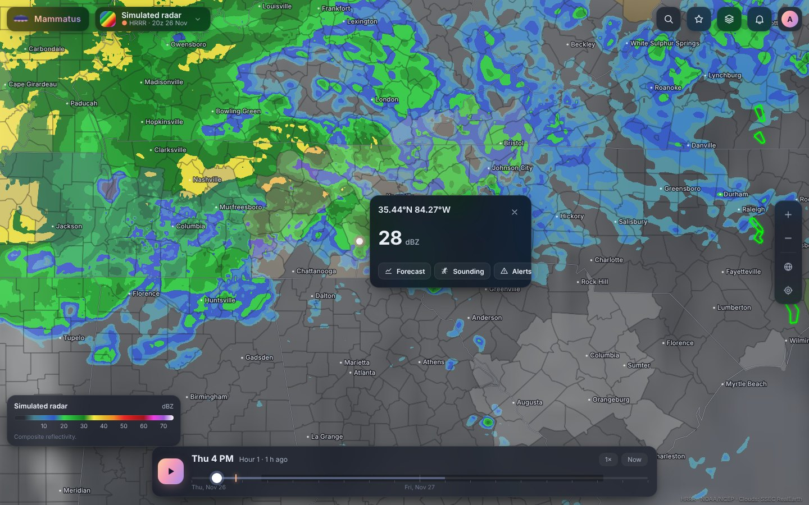 | 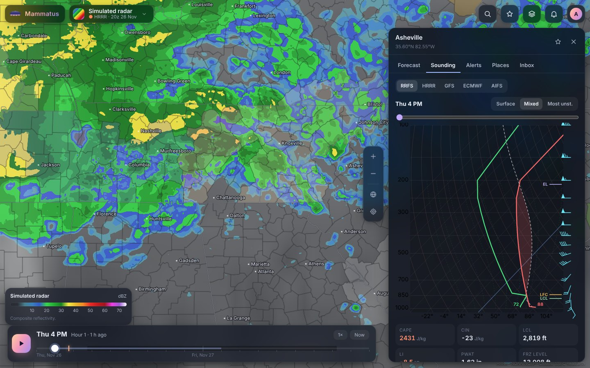 |
| HRRR simulated radar at county level, tap for details | Skew-T and indices (demo profile) |

<p align="center">
  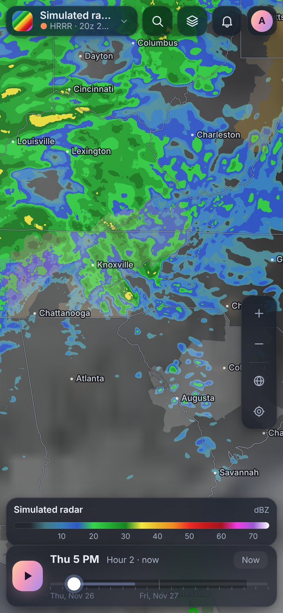
  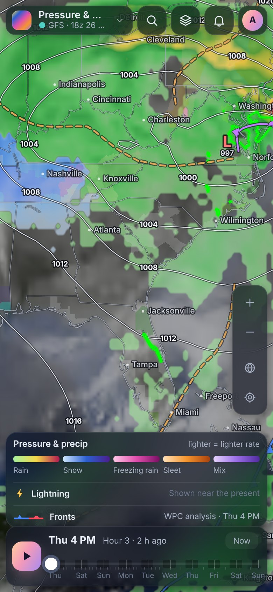
  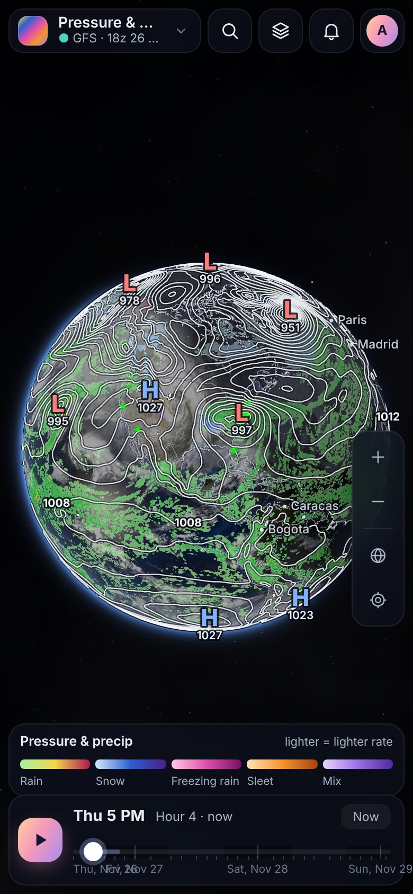
  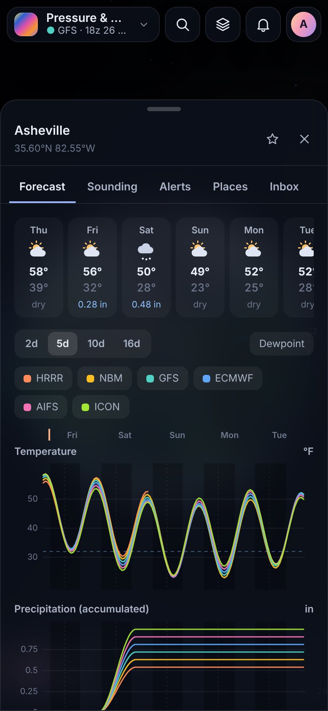
</p>

<p align="center"><sub>Meteogram and sounding screenshots use demo data; the maps are real model output.</sub></p>

## Install on Unraid

1. **Apps → search "Mammatus"** if the template is listed, or add the template URL
   `https://raw.githubusercontent.com/au12/Mammatus/main/unraid/mammatus.xml` under
   *Docker → Add Container → Template repositories*.
2. Set the **Data** path (default `/mnt/user/appdata/mammatus`) and the **Public URL** you'll use
   (for example `https://wx.example.com`).
3. Start the container and open the log: it prints a one-time **setup code**. Open the web UI, enter the
   code and create the admin account. (Or set `MAMMATUS_ADMIN_USER` / `MAMMATUS_ADMIN_PASSWORD` for the
   first start.)
4. Settings → Users → **Create invite link** for each person you want to add.

### Docker Compose

```yaml
services:
  mammatus:
    image: ghcr.io/au12/mammatus:latest
    container_name: mammatus
    restart: unless-stopped
    ports: ["8080:8080"]
    volumes: ["./data:/data"]
    environment:
      MAMMATUS_PUBLIC_URL: https://wx.example.com
      MAMMATUS_CONTACT: you@example.com
      TZ: America/New_York
```

## Remote access

Put Mammatus behind HTTPS (Nginx Proxy Manager, Caddy, Traefik…). HTTPS is required for sign-in from
outside, installing the app and push notifications. See **[docs/reverse-proxy.md](docs/reverse-proxy.md)**
for an Nginx Proxy Manager walkthrough and the security model.

### Notifications on phones

- **Android / desktop:** Settings → Notifications → turn on *Push notifications*.
- **iPhone / iPad (iOS 16.4+):** open the site in Safari, *Share → Add to Home Screen*, open Mammatus from
  the home screen, then turn on notifications in Settings.
- Add places (tap the map, then ★) and create rules in Settings → Notifications.

## Configuration

| Variable | Default | |
|---|---|---|
| `MAMMATUS_PUBLIC_URL` | — | External `https://` URL; used for invite links, secure cookies and push |
| `MAMMATUS_MODELS` | `hrrr,rrfs,gfs,ecmwf,aifs` | Models to offer |
| `MAMMATUS_CACHE_GB` | `10` | Frame cache size cap |
| `MAMMATUS_RETENTION_HOURS` | `54` | How long model frames are kept |
| `MAMMATUS_TRUSTED_PROXIES` | private networks | Who may set `X-Forwarded-For/Proto` |
| `MAMMATUS_HSTS` | `false` | Send `Strict-Transport-Security` |
| `MAMMATUS_SESSION_DAYS` | `30` | Session lifetime |
| `MAMMATUS_CONTACT` | — | Contact email for NOAA/NWS User-Agent and Web Push |
| `MAMMATUS_LIGHTNING` | `east,west` | GOES lightning sources: `east,west`, `east` (covers the lower 48) or `off` |
| `MAMMATUS_LIGHTNING_BACKFILL_MIN` | `30` | History fetched when someone turns lightning on (older radar frames fetch theirs on demand) |
| `MAMMATUS_OPENMETEO_URL` | `https://api.open-meteo.com` | Point forecasts & soundings (self-hosted Open-Meteo works) |
| `MAMMATUS_OPENMETEO_KEY` | — | Optional commercial Open-Meteo key |
| `MAMMATUS_ADMIN_USER` / `_PASSWORD` | — | Create the first admin without the setup code |
| `TZ` | `America/New_York` | Default display time zone (users can override) |
| `PUID` / `PGID` | `99` / `100` | User the app runs as |

## How it works

- **Backend:** Python (FastAPI + uvicorn). Run discovery lists the NOAA/ECMWF buckets once per run; frames
  are fetched with HTTP byte ranges using each file's index (only the fields needed), decoded with
  ecCodes, derived (winds rotated to earth-relative, accumulations, Kuchera snow, precip type, vorticity…),
  quantized to 16-bit, delta-coded and gzip-compressed into three levels of detail. Mirrors are tried in
  order (AWS → Google Cloud → NOMADS/ECMWF). Everything lives in SQLite and a size-capped disk cache.
- **Lightning:** GLM publishes 20-second netCDF files (170–360 KB, of which the flashes are a few KB).
  Mammatus only downloads them while someone has the layer on (about 100 MB per hour for both
  satellites, 65 MB for East alone), splits the overlap between the satellites at the longitude
  closest to each one's nadir, and serves 10-minute chunks of 7 bytes per flash. Complete chunks are
  immutable, so browsers download each one once; the live edge is polled for just the newest strikes.
  On the map, frames are only drawn while a visible strike is flashing.
- **Frontend:** dependency-free ES modules and a custom WebGL2 renderer: an analytic globe/Mercator
  projection with exact inverse per pixel, data textures sampled in-shader on the model's native grid
  (lat/lon or Lambert conformal), perceptual OKLab color ramps, GPU particle advection with transform
  feedback, instanced anti-aliased lines, Web Workers for decoding and contouring. The whole app is
  about 55 kB gzipped.

## Development

```bash
pip install -r requirements.txt
MAMMATUS_DATA_DIR=./data python -m mammatus          # serves mammatus/static (unbundled) on :8080
cd tools && npm install && npm run build              # production bundle -> mammatus/static-dist
pytest -q
```

Basemap, star and texture assets are prebuilt in `mammatus/static/data` and `mammatus/static/img`
(`tools/fetch_sources.sh`, `tools/build_assets.mjs`, `tools/build_textures.py` regenerate them);
`tools/build_icons.mjs` renders the icon set from the logo source.

## Credits

Model data: NOAA (HRRR, RRFS, GFS via the NOAA Open Data Dissemination program) and ECMWF open data
(IFS, AIFS; CC BY 4.0). Radar: NOAA MRMS. Lightning: NOAA GOES-R Geostationary Lightning Mapper.
Fronts: NOAA/NWS Weather Prediction Center. Satellite: courtesy of SSEC, University of Wisconsin–Madison
(RealEarth). Alerts: National Weather Service. Point forecasts and soundings: Open-Meteo (CC BY 4.0).
Basemap: Natural Earth, US Census via us-atlas. Earth imagery: NASA Blue Marble & Black Marble.
Stars: Yale Bright Star Catalog. QR codes: qrcode-generator (MIT).

## License

MIT
